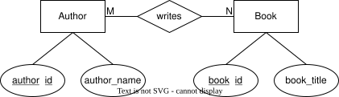

### Exercise A
Entity | Attributes
--- | ---
Book | book_id (PK), book_title
Author | author_id (PK), author_name

---
### Excercise B: Junction Table
- Entity Attributes Table
    Book | Author
    --- | --- 
    book_id (PK) | author_id (PK)
    book_title | author_name
    date_published

- Junction Table
    book_authors | |
    --- | ---
    book_id | (PK, FK -> Book.book_id)
    author_id | (PK, FK -> Author.author_id)
    author_order